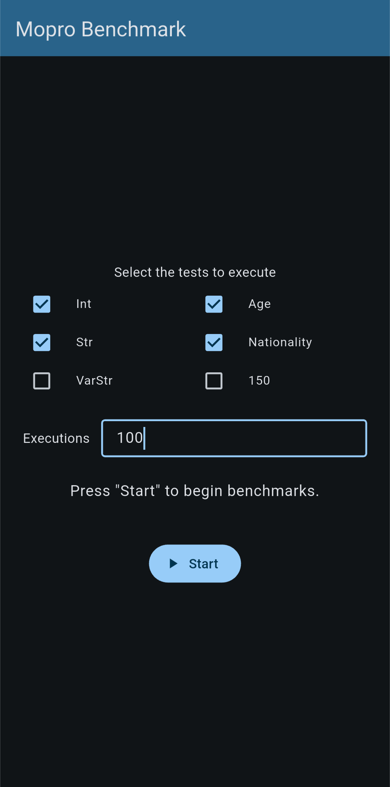

# Authenticated Witness Binding for ZKPs

A proof of concept exploring **authenticated witness binding for Zero-Knowledge Proofs (ZKPs)** over mobile driving licences (ISO/IEC 18013-5 mDL). An issuer commits to each attribute of the credential: the MSO it signs holds the digest of every `IssuerSignedItemBytes`. The ZKP circuit receives the private item, recomputes its digest, checks it against the issuer's commitment, and proves a predicate on the attribute without revealing it.

## Overview

Six variants are implemented. Variants are named as in the benchmark (`tests/comparison.py`); the directory of each is in the project structure below (e.g. `sha256-iso` is `implementations/iso/sha256`).

| Variant | Authentication | Notes |
|---|---|---|
| `base` | None | The predicate only, on the elementValue as issued: the reference for the cost of authentication |
| `sha256-iso` | SHA-256 item digest | The commitment is the MSO digest of `IssuerSignedItemBytes`, parsed as issued |
| `sha512-iso` | SHA-512 item digest | As above; ISO/IEC 18013-5 also allows SHA-512 |
| `poseidon-iso` | Poseidon item digest | As above, for comparison only: ISO/IEC 18013-5 allows only SHA-2 |
| `longfellow` | SHA-256 + in-circuit ECDSA P-256 | Noir port of the Longfellow-zk mdoc circuit: the issuer-signed MSO is parsed in the circuit with path checks, and the issuer and device signatures are verified |
| `vega` | SHA-256 + in-circuit ECDSA P-256 | Noir port of the VegaSC mdoc circuit (Figure 9a of the Vega paper): length-hiding SHA-256, lookup-based field extraction without CBOR parsing, issuer and device signatures in-circuit |

`docs/papers/PORTED.md` explains how the two ports follow their papers, and `docs/papers/NOT_PORTED.md` why Crescent and VegaMC are not ported.

Every variant runs four **scenarios**, real mDL presentations, each on an attribute of a different CBOR type:

| Scenario | Use case | Data element | CBOR type | Predicate |
|---|---|---|---|---|
| `age` | Alcohol sale | `birth_date` (`org.iso.18013.5.1`) | full-date (tag 1004) | The holder is at least 21 today |
| `rental` | Car rental | `driving_privileges` (`org.iso.18013.5.1`) | array of maps | A category B privilege held for at least 2 years and valid until the car is returned |
| `residence` | Resident discount | `resident_postal_code` (`org.iso.18013.5.1`) | text string | The ZIP code (ZIP or ZIP+4) is in the municipality's range |
| `veteran` | Veteran discount | `veteran` (`org.iso.18013.5.1.aamva`) | unsigned integer | The value is 1 |

The circuits run on mDLs issued by [pyMDOC-CBOR](https://github.com/IdentityPython/pyMDOC-CBOR), an implementation independent of the circuits, for four test holders: see `credentials/README.md`.

---

## Project Structure

```
authenticated-zkp/
├── credentials/              # Test mDLs and the circuit inputs (see credentials/README.md)
│   ├── holders.py            # The four holders' data and the scenarios' public parameters
│   ├── issue.py              # Issues the mDLs with pyMDOC-CBOR (test PKI in pki/)
│   ├── present.py            # In-person presentation sessions and device signatures
│   ├── inputs.py             # Circuit inputs of every variant from an issued mDL
│   ├── generate.py           # Writes Prover.toml and the Dart inputs of every circuit
│   ├── testkit.py            # Helpers of the soundness tests
│   └── holders/  pki/        # The issued credentials (committed)
├── docs/
│   ├── papers/               # Longfellow, Crescent and Vega papers
│   │   ├── PORTED.md         # How Longfellow and VegaSC were ported, and every departure
│   │   └── NOT_PORTED.md     # Why Crescent and VegaMC are not ported
│   └── testing-app.png       # Screenshot of the testing application
├── implementations/
│   ├── base/                 # The predicate only (variant base)
│   │   └── age/  rental/  residence/  veteran/
│   │
│   ├── iso/                  # ISO/IEC 18013-5 item digests
│   │   ├── sha256/           # SHA-256 digest (variant sha256-iso)
│   │   ├── sha512/           # SHA-512 digest (variant sha512-iso)
│   │   ├── poseidon/         # Poseidon digest, comparison only, not ISO (variant poseidon-iso)
│   │   │   └── age/  rental/  residence/  veteran/
│   │   └── common/           # Shared by every variant
│   │       ├── lib/          # Noir library: IssuerSignedItemBytes parsing and SHA-256, the CBOR
│   │       │                 # parser (cbor.nr) and the scenario predicates (predicates.nr)
│   │       ├── sha512/       # Noir library: SHA-512 of the item
│   │       ├── poseidon/     # Noir library: Poseidon of the item
│   │       ├── hasher/       # Noir program computing the Poseidon digest for credentials/
│   │       └── test_soundness.py # Item parsing and predicate attacks
│   │
│   ├── longfellow/           # Noir port of the Longfellow-zk mdoc circuit (see longfellow/README.md)
│   │   ├── lib/              # Noir library: SHA-256, in-circuit CBOR parsing of the MSO, signatures
│   │   ├── age/  rental/  residence/  veteran/
│   │   └── test_soundness.py # Attacks the circuit must reject, including fields at the wrong path
│   │
│   └── vega/                 # Noir port of the VegaSC mdoc circuit (see vega/README.md)
│       ├── lib/              # Noir library: length-hiding SHA-256, lookup field extraction, signatures
│       ├── age/  rental/  residence/  veteran/
│       └── test_soundness.py # Attacks the circuit must reject, and Vega's parsing assumption
│
│   Each scenario directory contains:
│       ├── src/main.nr       # Noir circuit
│       ├── Nargo.toml        # Noir package manifest
│       ├── Prover.toml       # Inputs of holder1
│       └── inputs_*.dart     # Inputs of the four holders (runs 1 to 4)
│
├── scenarios/
│   └── mdl/                  # The circuits and inputs for the testing application (see its README)
│       ├── circuits/         # Compiled circuits, <variant>_<scenario>.json
│       └── inputs/           # Dart inputs of every variant, per scenario
│
└── tests/
    ├── comparison.py         # Benchmarks gates and proving times of every variant
    ├── comparison-results.md   # Report of comparison.py (summary, every circuit, comparisons)
    ├── comparison-results.json # Its raw measurements (--report rebuilds the report from them)
    ├── soundness.py          # Runs the soundness tests of every variant (iso, longfellow, vega)
    ├── SOUNDNESS.md          # What the soundness tests check, per implementation
    └── testing-app.apk       # Android application (not yet updated to the mDL scenarios)
```

---

## Running Locally

In order to generate and verify proofs on a local machine, the following needs to be installed:

- [Noir](https://noir-lang.org/) (`nargo`, 1.0.0) — circuit language and compiler
- [Barretenberg](https://github.com/AztecProtocol/aztec-packages/tree/master/barretenberg) (`bb`, 6.0.0, from the Aztec v6.0.0 release) — proving backend
- Python 3 with the packages of `credentials/requirements.txt`, for the credentials and the tests

```
cd credentials && python3 -m venv .venv && .venv/bin/pip install -r requirements.txt
.venv/bin/python generate.py                 # Prover.toml and Dart inputs of every circuit
cd ../implementations/vega/age && nargo execute
cd ../../../ && python3 tests/comparison.py  # writes tests/comparison-results.md
credentials/.venv/bin/python tests/soundness.py --quiet  # every soundness test
```

---

## Running the Testing Application

The testing application was developed to be installed on Android devices only. Currently, there is no iOS version. After installing the application, the desired tests can be selected, as well as the number of executions. The results are then written to a `.json` file in the testing device. The path is displayed in a message box. The image below demonstrates how this can be done. The application has not yet been updated to the mDL scenarios of `scenarios/mdl`.


