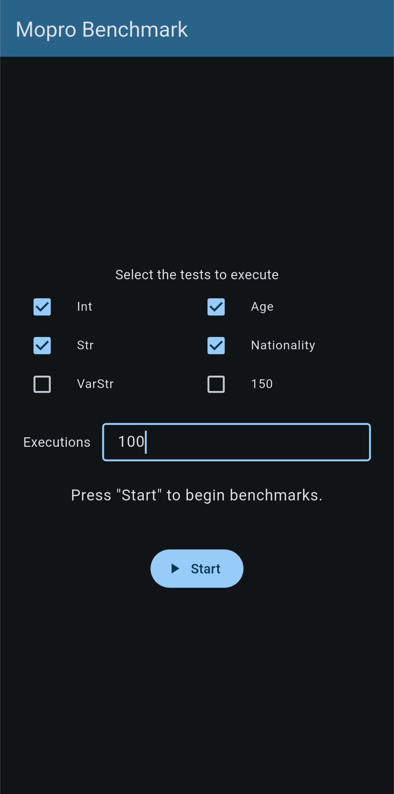

# Authenticated Witness Binding for ZKPs

A proof of concept exploring **authenticated witness binding for Zero-Knowledge Proofs (ZKPs)** using different hash functions. The core idea is that a trusted source (e.g. an identity document issuer) provides a hash of a private attribute. The ZKP circuit receives that hash as a public input, recomputes it internally over the private attribute, and asserts they match — proving knowledge of the attribute without revealing it.

## Overview

Five variations are implemented, differing in the hash function used to bind the private attribute:

| Variation | Hash Function | Notes |
|-----------|--------------|-------|
| `base` | None | No hash binding; attribute is not verified against an external commitment |
| `sha256` | SHA-256 | Supported by the ISO/IEC 18013-5 mDoc standard |
| `sha512` | SHA-512 | Supported by the ISO/IEC 18013-5 mDoc standard |
| `mimc` | MiMC BN254 | ZKP-friendly hash function; low circuit complexity |
| `poseidon` | Poseidon | ZKP-friendly hash function; widely used in ZK protocols |
| `sha256-iso`, `sha512-iso`, `poseidon-iso`, `base-iso` | as above | ISO/IEC 18013-5 inputs: the commitment is the MSO digest of `IssuerSignedItemBytes` (digestID, random, elementIdentifier, elementValue) and values use their ISO encoding; `poseidon-iso` is for comparison only, as ISO 18013-5 allows only SHA-2. `int`, `age`, `nationality` and `str` scenarios. |
| `longfellow` | SHA-256 + in-circuit ECDSA P-256 | Noir port of the Longfellow-zk mdoc circuit (issuer and device signatures verified in-circuit); `int`, `age`, `nationality` and `str` scenarios. |

Each variation includes three **scenarios**. The primary scenario emulates identity-related attribute proofs:

| Scenario | Name     | Description |
|----------|----------|-------------|
| Primary  | `age`    | Prove that a date of birth corresponds to an age above a threshold |
|          | `int`    | Prove that a private integer satisfies a comparison (e.g. `x > y`) |
|          | `nationality` | Prove that a nationality code belongs to an allowed list |
|          | `str`    | Prove that a substring appears within a larger private string (e.g. an address) |
| VarStr   | varstr-32  | Substring test with string lengths of 32 characters  | 
|          | varstr-64  | Substring test with string lengths of 64 characters  | 
|          | varstr-128 | Substring test with string lengths of 128 characters | 
|          | varstr-256 | Substring test with string lengths of 256 characters | 
|          | varstr-512 | Substring test with string lengths of 512 characters |
| 150      | varstr-150 | Substring test with string lengths of 150 characters |

---

## Project Structure

```
authenticated-zkp/
├── docs/
│   └── testing-app.png       # Screenshot of the testing application
├── implementations/
│   ├── base/                 # No hash authentication
│   ├── sha256/               # SHA-256 hash version
│   ├── sha512/               # SHA-512 hash version
│   ├── poseidon/             # Poseidon hash version
│   │   └── age/  int/  nationality/  str/  varstr/
│   │
│   ├── base-iso/             # ISO/IEC 18013-5 inputs (CBOR), no hash authentication
│   ├── sha256-iso/           # ISO/IEC 18013-5: SHA-256 MSO digest of IssuerSignedItemBytes
│   ├── sha512-iso/           # ISO/IEC 18013-5: SHA-512 MSO digest of IssuerSignedItemBytes
│   ├── poseidon-iso/         # Same item hashed with Poseidon (comparison only, not ISO)
│   │   └── age/  int/  nationality/  str/
│   ├── iso/                  # Shared code of the -iso variants (see iso/README.md)
│   │   ├── lib/              # Noir library: CBOR decoding, IssuerSignedItemBytes, SHA-256
│   │   ├── sha512/           # Noir library: SHA-512 of the item
│   │   ├── poseidon/         # Noir library: Poseidon of the item
│   │   ├── hasher/           # Noir program computing the Poseidon digest for generate.py
│   │   └── generate.py       # Builds (or reads) an item and writes Prover.toml / Dart inputs
│   │
│   └── longfellow/           # Noir port of the Longfellow-zk mdoc circuit (see longfellow/README.md)
│       ├── lib/              # Noir library: in-circuit MSO, signature and device checks
│       ├── age/  int/  nationality/  str/
│       ├── generate.py       # Builds a signed credential and writes Prover.toml / Dart inputs
│       └── test_soundness.py # Attacks the circuit must reject
│
│   Each scenario directory contains:
│       ├── src/main.nr       # Noir circuit
│       ├── Nargo.toml        # Noir package manifest
│       ├── Prover.toml       # Proof inputs
│       ├── bytes.sh          # Helper script to compute inputs and hash (original variants)
│       ├── inputs_*.dart     # Inputs of the four test runs (-iso and longfellow variants)
│       └── target/           # Compiled artifacts and proofs
│
└── tests/
    ├── 150/                  # Content for the varstr-150 test
    ├── primary/              # Content for the primary test
    ├── varstr/               # Content for the varstr test
    ├── comparison.py         # Benchmarks gates and proving times of every variant
    ├── comparison-results.txt  # Output of comparison.py
    └── testing-app.apk       # Android application to run the tests

    Each test directory contains:
        ├── circuits/         # Circuits used
        └── inputs/           # Inputs used
```

---

## Running Locally

In order to generate and verify proofs on a local machine, the following needs to be installed:

- [Noir](https://noir-lang.org/) (`nargo`) — circuit language and compiler
- [Barretenberg](https://github.com/AztecProtocol/aztec-packages/tree/master/barretenberg) (`bb`) — proving backend

---

## Running the Testing Application

The testing application was developed to be installed on Android devices only. Currently, there is no iOS version. After installing the application, the desired tests can be selected, as well as the number of executions. The results are then written to a `.json` file in the testing device. The path is displayed in a message box. The image below demonstrates how this can be done.




